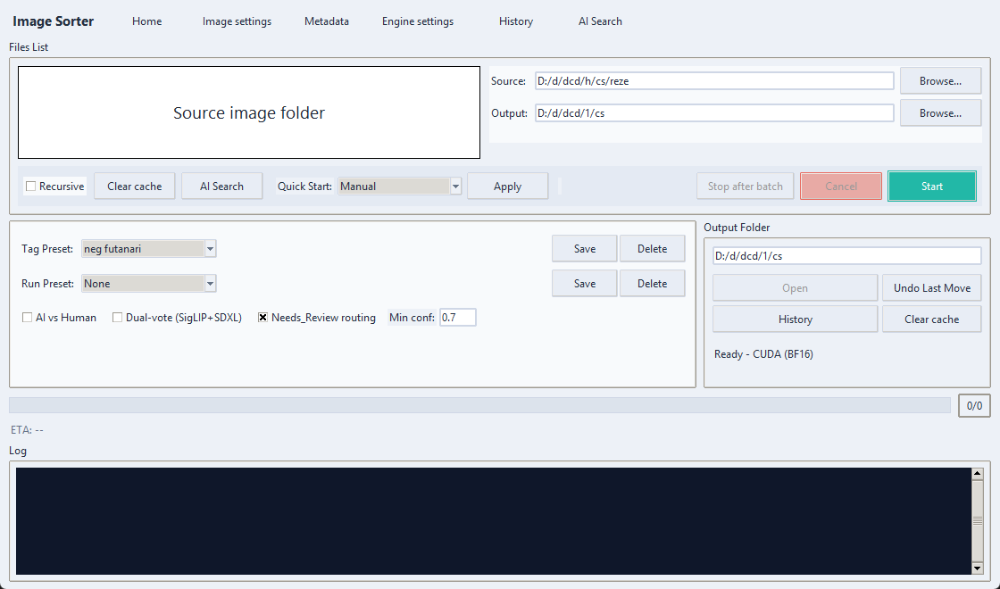

# Intelligent Photo Organizer & Semantic Image Sorter

[](https://www.python.org/downloads/)
[](https://pytorch.org/)
[](LICENSE)
[](https://developer.nvidia.com/cuda-toolkit)

An edge-native, privacy-preserving desktop application for automated curation, classification, deduplication, and zero-shot semantic retrieval across large personal image libraries. Built with an ensemble of 8 computer vision and multimodal foundation models running entirely on local hardware.



---

## Quick Demo in 3 Steps

### 1. Clone & Set Up Environment
```bash
git clone https://github.com/Shirsh-Barnwal/Intelligent-Photo-Organizer.git
cd Intelligent-Photo-Organizer

python -m venv venv
# Windows:
.\venv\Scripts\activate
# Linux/macOS:
source venv/bin/activate

pip install -r requirements.txt
```

### 2. Download Model Weights
Weights are verified and pulled from Hugging Face Hub into `data/models/`:
```bash
python scripts/download_models.py
```
*(Alternatively, simply launching the app will automatically check and download any missing models).*

### 3. Launch GUI
```bash
python -m app.main
```
*(Or run `python sort_images_app.py`)*

---

## 2-Minute Live Demo Script (For Interviews & Presentations)

When presenting this project live, follow this quick sequence to showcase end-to-end functionality:

1. **Load Test Images**: Drag and drop any folder containing a mix of camera photos, screenshots, wallpapers, or AI art into the **Source Folder** field. Set a destination **Target Folder**.
2. **Select Sorting Preset**: Pick **"Max Quality"** from the Quick Start dropdown (enables AI detection, content filtering, style categorization, deduplication, and visual clustering).
3. **Execute Pipeline**: Hit **Start**. Point out the real-time VRAM allocation, dynamic batch sizing, and live ETA calculation.
4. **Showcase Zero-Shot Semantic Search**:
   - Click the **"AI Search"** button.
   - Enter a descriptive prompt (e.g., *"sunset over calm ocean"*, *"vintage retro car"*, or *"cat lying on a bed"*).
   - Show how SigLIP2 zero-shot vector similarity ranks and retrieves matches directly from cached embeddings without external API calls or internet access.
5. **Demonstrate Safety & Rollback**:
   - Open **Run History** and click **Undo Last Move**.
   - Show how the transaction journal (`.undo_last_move.json`) atomically restores files to their original paths with zero data loss.

---

## System Architecture

The pipeline processes images through a multi-stage sequential filter followed by visual embedding, dimensionality reduction, and hierarchical clustering:

```
                  ┌──────────────────────────────────────────────┐
                  │          Input Folder (Images / Raw)         │
                  └──────────────────────┬───────────────────────┘
                                         │
                                         ▼
                  ┌──────────────────────────────────────────────┐
                  │    High-Throughput LMDB Binary Cache Engine   │
                  │   (MD5 hashing, zero disk fragmentation I/O) │
                  └──────────────────────┬───────────────────────┘
                                         │
                                         ▼
                  ┌──────────────────────────────────────────────┐
                  │           Stage 1: Binary Triage             │
                  │  • ViT AI-vs-Human Detector                  │
                  │  • SDXL Swin Consensus Voting                │
                  │  • Uncertainty Routing (Needs_Review)        │
                  └──────────────────────┬───────────────────────┘
                                         │
                                         ▼
                  ┌──────────────────────────────────────────────┐
                  │        Stage 2: Zero-Shot Semantics          │
                  │  • Google SigLIP2 (Text & Style Anchors)     │
                  │  • Contrastive Cosine Margin Classification  │
                  └──────────────────────┬───────────────────────┘
                                         │
                                         ▼
                  ┌──────────────────────────────────────────────┐
                  │          Stage 3: Deep Tagging               │
                  │  • SmilingWolf WD EVA02-Large / Camie ONNX   │
                  │  • Character Recognition & Auto-Routing      │
                  └──────────────────────┬───────────────────────┘
                                         │
                                         ▼
                  ┌──────────────────────────────────────────────┐
                  │       Stage 4: Feature Representation        │
                  │  • Meta DINOv2 Base (Multi-scale: CLS+Pool)  │
                  │  • Custom 3-Layer Projection Adapter (384-d) │
                  └──────────────────────┬───────────────────────┘
                                         │
                                         ▼
                  ┌──────────────────────────────────────────────┐
                  │       Stage 5: Clustering & Dedup            │
                  │  • Chunked Cosine Pairwise Deduplication     │
                  │  • UMAP Non-Linear Manifold Projection       │
                  │  • Ward's Agglomerative Hierarchical Grouping│
                  │  • TF-IDF Semantic Rarity Cluster Naming     │
                  └──────────────────────┬───────────────────────┘
                                         │
                                         ▼
                  ┌──────────────────────────────────────────────┐
                  │       Stage 6: Output & Safety Layer         │
                  │  • Structured Destination Reorganization     │
                  │  • Florence-2 Detailed Metadata Generation   │
                  │  • Atomic Move Journal (.undo_last_move.json)│
                  └──────────────────────────────────────────────┘
```

---

## Foundation Models & Roles

| Model | Hugging Face Repository | Primary Function | Technical Reason for Selection |
|---|---|---|---|
| **AI vs Human Detector** | `Ateeqq/ai-vs-human-image-detector` | Binary classification | High precision ViT trained on real photography vs synthetic diffusion outputs. |
| **SDXL Detector** | `umm-maybe/AI-image-detector` | Consensus verification | Specialized Swin Transformer tuned for high-resolution SDXL/Midjourney artifacts. |
| **SigLIP2 SO400M** | `google/siglip2-so400m-patch16-512` | Zero-shot tags & search | Sigmoid loss formulation yields significantly better zero-shot text/image alignment than CLIP. |
| **DINOv2 Base** | `facebook/dinov2-base` | Visual feature extraction | Self-supervised Vision Transformer capturing dense spatial semantics without label bias. |
| **WD EVA02 Tagger v3** | `SmilingWolf/wd-eva02-large-tagger-v3` | Multi-label concept tagging | EVA-02 architecture exported to ONNX; detects 10,000+ visual concepts and characters. |
| **Camie Tagger v2** | `Camais03/camie-tagger-v2` | Lightweight anime/art tagging | Fast alternative ONNX runtime model optimized for stylized illustrations. |
| **Florence-2 Large** | `MiaoshouAI/Florence-2-large-PromptGen-v2.0` | Detailed captioning | Lightweight vision-language model generating detailed descriptive prompts for training data. |
| **MiniLM-L6-v2** | `sentence-transformers/all-MiniLM-L6-v2` | Tag embedding space | Compact 384-dim semantic space used as the contrastive target for adapter alignment. |

---

## Key Engineering Decisions & Interview Talking Points

### 1. High-Throughput I/O with Memory-Mapped LMDB
- **Problem**: Reading tens of thousands of individual JPEG/PNG files from consumer SSDs or mechanical drives creates an I/O bottleneck due to file-system open/read/close syscall overhead.
- **Solution**: A unified LMDB (Lightning Memory-Mapped Database) caching layer (`app/caching.py`). Raw images are stored with MD5 fingerprinting and accessed via memory pointers, providing multi-process zero-copy reads and speeding up batch inference by 3x–5x.

### 2. Multi-Scale DINOv2 Visual Features
- **Problem**: Standard ViT CLS tokens capture global scene composition but often lose fine-grained spatial and background details.
- **Solution**: We concatenate the 768-dim `[CLS]` token with 768-dim mean-pooled spatial patch tokens, creating a 1,536-dimensional feature representation that captures both global context and fine local textures.

### 3. Manifold Learning & Hierarchical Clustering
- **Problem**: K-Means clustering requires specifying cluster counts in advance and struggles with complex non-spherical visual manifolds.
- **Solution**: We reduce high-dimensional feature vectors using **UMAP** (Uniform Manifold Approximation and Projection) with cosine distance, followed by **Ward's Agglomerative Hierarchical Clustering**. Post-processing merges adjacent clusters whose centroid cosine similarity exceeds a tunable threshold.

### 4. Contrastive Adapter Training with InfoNCE + Cosine Loss
- **Problem**: Aligning visual representations with textual descriptions often leads to representation collapse or mode drift.
- **Solution**: The custom projection adapter (`app/training.py`) uses a combined loss function:
  $$\mathcal{L} = 0.7 \cdot \mathcal{L}_{\text{Cosine}} + 0.3 \cdot \mathcal{L}_{\text{MSE}} + \lambda \|\theta\|_2^2$$
  Supported by Exponential Moving Average (EMA) weight updates and a OneCycle learning rate policy with cosine decay.

### 5. Dynamic VRAM Budgeting & CUDA OOM Protection
- **Problem**: Loading multiple multi-gigabyte models simultaneously can exceed consumer GPU memory limits (4GB–12GB).
- **Solution**: `app/models.py` profiles free VRAM before loading each component, selects optimal batch sizes dynamically, supports FP16/BF16/FP32 precision automatically, and implements an automatic memory offload strategy that flushes inactive model tensors to host RAM.

### 6. Transactional Safety & Non-Destructive Operations
- **Problem**: Organizing hundreds of gigabytes of photos risks irreversible file loss or accidental deletion.
- **Solution**: Every file move is recorded in a transaction journal (`.undo_last_move.json`). The user can test runs risk-free using **Dry Run** mode, or undo any move batch with a single click.

---

## Codebase Organization

The project is structured into 10 cohesive modules designed for clean separation of concerns:

```text
intelligent-photo-organizer/
├── app/
│   ├── __init__.py           # Package exports & version
│   ├── main.py               # Application entry point, CLI flags & DPI scaling
│   ├── ui.py                 # Tkinter dark-theme GUI, modals & event workers
│   ├── pipeline.py           # Core sorting pipeline orchestrator & run journal
│   ├── models.py             # ModelManager, Hugging Face downloaders & inference
│   ├── caching.py            # LMDB cache reader/writer, PyTorch ImagePathDataset
│   ├── clustering.py         # UMAP reduction, Ward clustering, cosine deduplication
│   ├── tagging.py            # ONNX tagger inference, semantic vectors, TF-IDF naming
│   ├── search.py             # Local zero-shot semantic search over SigLIP embeddings
│   ├── training.py           # DINOv2 adapter training loop, EMA, OneCycleLR & CLI
│   └── utils.py              # Path management, VRAM budgeting, JSON persistence
├── scripts/
│   ├── download_models.py    # Standalone model verification & download script
│   ├── train_dinov.py        # CLI training runner for the DINOv2 adapter
│   └── extract_tags.py       # Standalone tagging utility to generate metadata.json
├── data/
│   ├── models/               # Local foundation model checkpoints (auto-downloaded)
│   ├── weights/              # Trained adapter checkpoints
│   └── cache/                # LMDB binary cache and settings
├── logs/                     # Historical sorting logs and execution journals
├── requirements.txt          # Python dependencies
├── sort_images_app.py        # Root launcher wrapper
├── download_models.py        # Root download wrapper
├── train_dinov.py            # Root training wrapper
├── extract_tags.py           # Root tagging wrapper
├── LICENSE                   # MIT License
└── USAGE.md                  # Comprehensive user manual
```

---

## Standalone CLI Utilities

For headless servers or automated scripts:

### Extract Visual Tags to JSON
```bash
python extract_tags.py --data_dir "/path/to/photos" --threshold 0.35 --engine wd
```

### Train Custom DINOv2 Adapter
```bash
python train_dinov.py --data_dir "/path/to/photos" --epochs 10 --batch_size 16 --augment light
```

---

## Requirements & Hardware Support

- **OS**: Windows 10/11, Ubuntu 20.04+, macOS (CPU inference supported)
- **Python**: 3.10 to 3.12
- **GPU (Recommended)**: NVIDIA GPU with 6GB+ VRAM (CUDA 12.1+ / 11.8)
- **CPU Mode**: Supported automatically when CUDA is not present

---

## License

This project is licensed under the MIT License — see the [LICENSE](LICENSE) file for details.
=======

